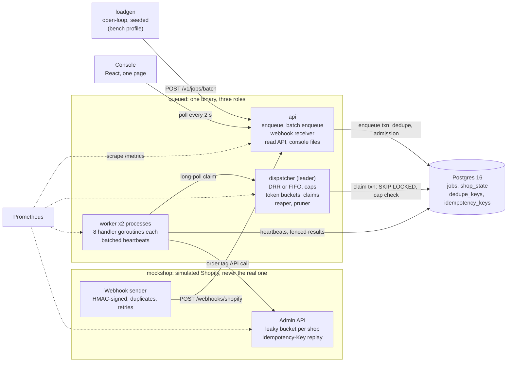
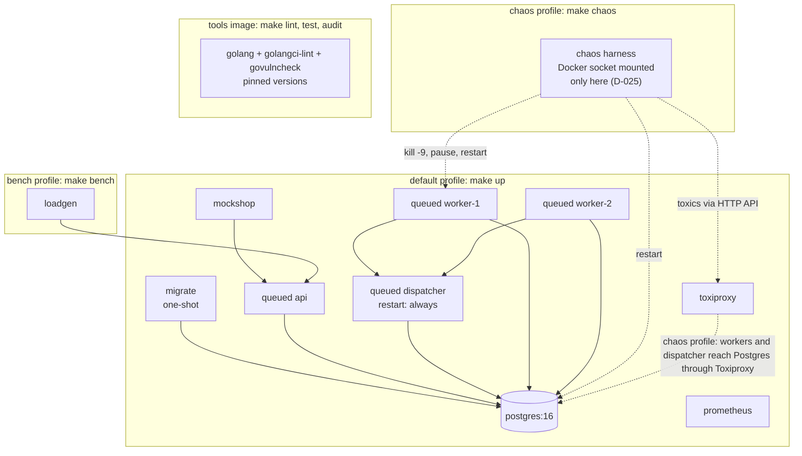
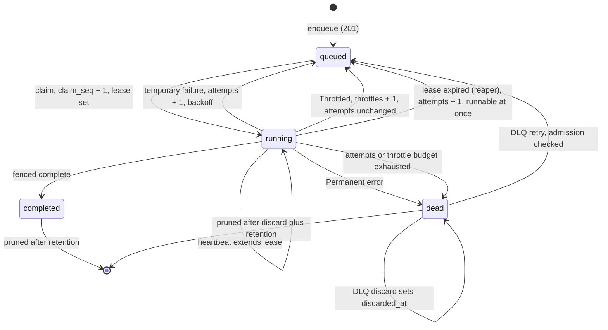
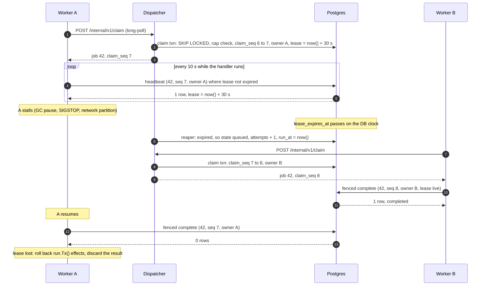
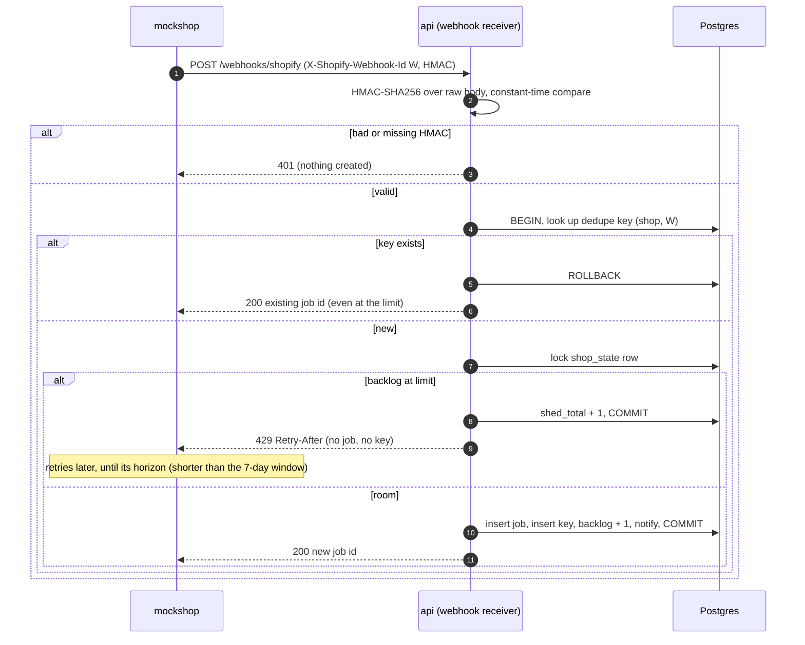
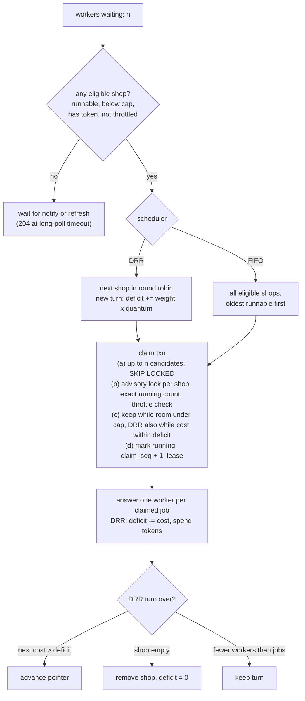
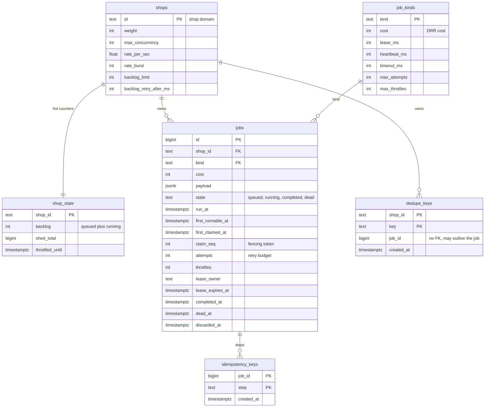
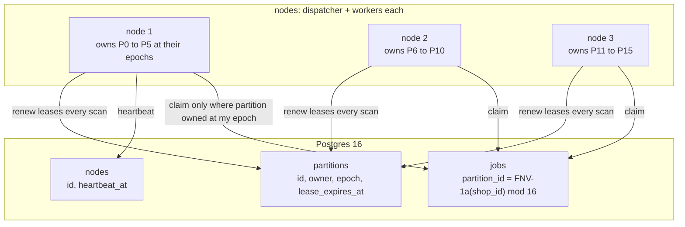
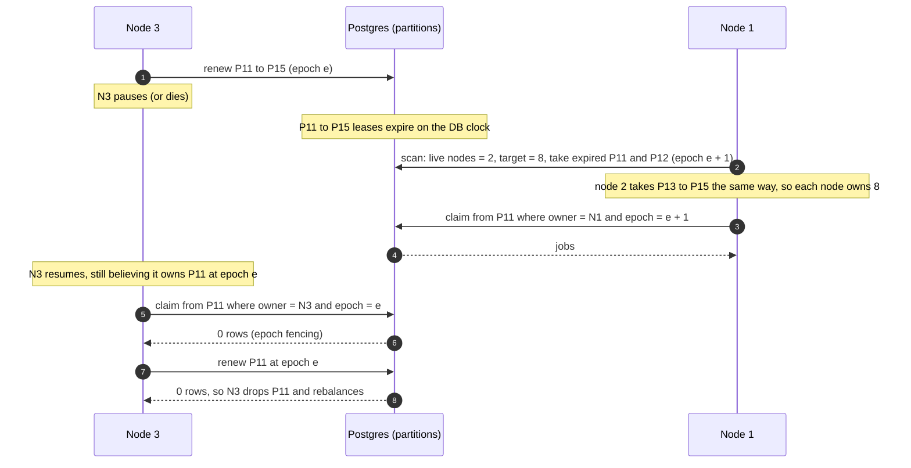

# Architecture

The diagrams for the queue. [`design.md`](design.md) gives the mechanisms behind each one, and [`decisions.md`](decisions.md) gives the reasons (D-xxx). GitHub renders every diagram here as Mermaid.

## 1. Components

## 2. Deployment (Docker Compose)

Every published port is bound to `127.0.0.1` (NFR-16). The `tools` image runs Go, golangci-lint and govulncheck, because nothing is installed on the Mac (D-021).

## 3. Job lifecycle

`queued` covers both runnable jobs (`run_at` ≤ `now()`) and scheduled ones. `claim_seq` rises on every claim, while `attempts` rises only on failures and expired leases (D-004).

## 4. Claim, heartbeat and a lost lease

This shows Q2 and the fencing rule. Every time comes from Postgres's `now()`.

A second path ends the same way. If A's heartbeat returns 0 rows while A is still running, A cancels the handler's context at once and never writes a result (AC-4.3).

## 5. Webhook path

This shows HMAC, dedupe before admission, and the 429 at the backlog limit (Q4, Q8, D-018).

## 6. One dispatcher decision

## 7. Data model

## 8. Sharded queue (3+, wave 2)

All 16 logical partitions live in one Postgres. A node is one dispatcher plus its workers, and it owns its partitions through leases that carry an epoch (D-016).

Failover and split brain:

